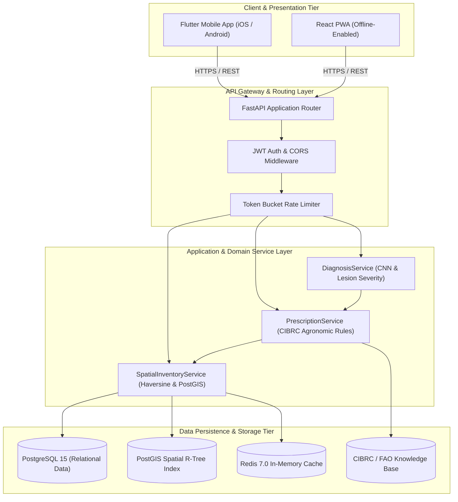

# System Architecture & Technical Specifications

## 1. High-Level Architectural Pattern: Clean Layered Architecture
PlantCare AI follows a **Clean Layered Architecture** with strict dependency rules pointing inward toward the Domain Core. This ensures that the deep learning vision inference, spatial database computations, and presentation layers can evolve independently without violating business logic.

---

## 2. Core Architectural Subsystems

### 2.1 Computer Vision & Severity Quantification Subsystem
- **Input Pipeline:** Receives RGB image stream, applies resize to $224 \times 224$ pixels, normalizes with ImageNet parameters ($\mu = [0.485, 0.456, 0.406]$, $\sigma = [0.229, 0.224, 0.225]$).
- **Classification Backbone:** Employs MobileNetV4 / EfficientNet-B0 pretrained on ImageNet and fine-tuned on agricultural pathology datasets (38 classes).
- **Lesion Severity Calculator:** Applies Otsu thresholding / semantic mask segmentation on the canopy region to compute necrotic surface area percentage:
  $$\text{Severity Percentage} = \left(\frac{\text{Area of Necrotic Lesion Pixels}}{\text{Total Green Leaf Canopy Pixels}}\right) \times 100$$

### 2.2 Agronomic Decision Support Subsystem
- Acts as a **Deterministic Expert Rule Engine** adhering to national regulatory guidelines (CIBRC, India).
- Disallows hazardous chemicals when a crop is healthy or near harvest (Pre-Harvest Interval enforcement).
- Emits dual therapeutic regimens:
  1. *Synthetic Curative / Protective:* Specific chemical active ingredient, commercial brand name, dosage per acre, and dilution.
  2. *Certified Organic / Bio-control:* Microbial antagonists (*Trichoderma*, *Bacillus*), botanical neem formulations, and cultural practices.

### 2.3 Hyperlocal Spatial Inventory & Routing Subsystem
- **Spatial Pre-filtering:** Applies coordinate bounding-box screening to eliminate $>92\%$ of stores using four comparison operators in $O(1)$ time.
- **Geodesic Distance Evaluation:** Calculates exact distance using the spherical Haversine formula.
- **Inventory Join & State Reservation:** Joins spatial candidate stores with relational inventory tables, enforcing atomic decrement on reservations to avoid race conditions.

---

## 3. Communication & Data Protocols
- **API Transport:** REST over HTTPS / TLS 1.3.
- **Serialization Format:** Strict JSON conforming to Pydantic v2 schemas.
- **Media Ingestion:** Multipart form-data for raw binary image streams; Base64 JSON payloads for low-overhead client integration.
- **Error Codes:** Standard HTTP status codes (200 OK, 400 Bad Request, 401 Unauthorized, 404 Not Found, 422 Unprocessable Entity, 500 Internal Error).
