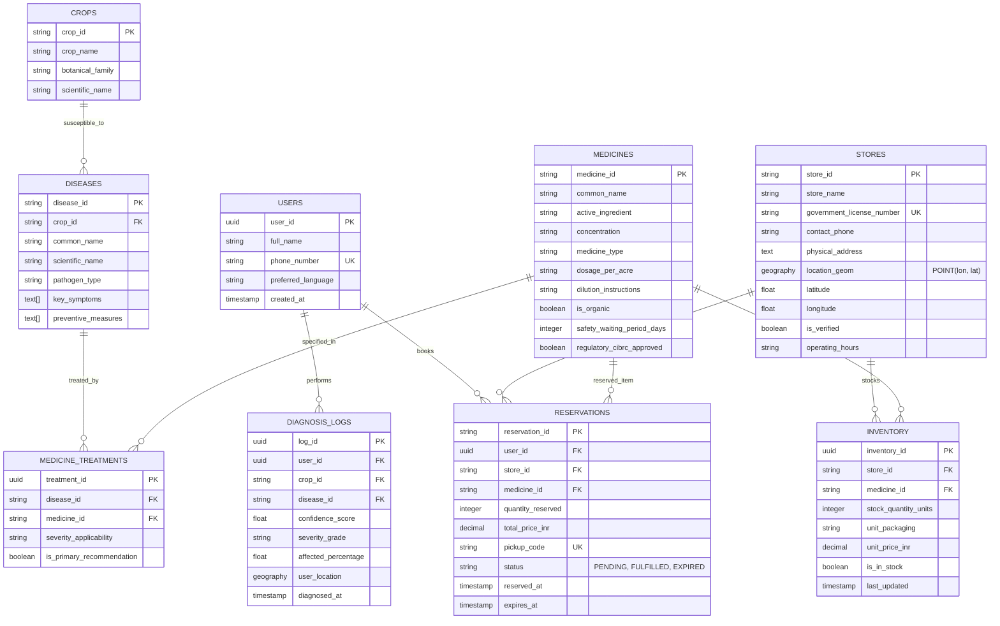

# Database Design & Entity-Relationship Diagram (ERD)

## 1. Entity-Relationship Diagram (Crow's Foot Notation)



---

## 2. Relational Schema & Spatial Indexing Definitions (PostgreSQL + PostGIS)

```sql
-- Enable PostGIS spatial extension
CREATE EXTENSION IF NOT EXISTS postgis;

-- 1. Agro-Stores Table with Spatial Point Geometry
CREATE TABLE stores (
    store_id VARCHAR(32) PRIMARY KEY,
    store_name VARCHAR(150) NOT NULL,
    government_license_number VARCHAR(50) UNIQUE NOT NULL,
    contact_phone VARCHAR(20) NOT NULL,
    physical_address TEXT NOT NULL,
    latitude DOUBLE PRECISION NOT NULL,
    longitude DOUBLE PRECISION NOT NULL,
    location_geom GEOMETRY(Point, 4326) GENERATED ALWAYS AS (ST_SetSRID(ST_MakePoint(longitude, latitude), 4326)) STORED,
    is_verified BOOLEAN DEFAULT TRUE,
    operating_hours VARCHAR(100) NOT NULL,
    created_at TIMESTAMP WITH TIME ZONE DEFAULT CURRENT_TIMESTAMP
);

-- Spatial R-Tree Index for Sub-Millisecond Radius Searching
CREATE INDEX idx_stores_spatial ON stores USING GIST (location_geom);

-- 2. Inventory Table with Concurrency Check
CREATE TABLE inventory (
    inventory_id UUID PRIMARY KEY DEFAULT gen_random_uuid(),
    store_id VARCHAR(32) REFERENCES stores(store_id) ON DELETE CASCADE,
    medicine_id VARCHAR(32) REFERENCES medicines(medicine_id) ON DELETE CASCADE,
    stock_quantity_units INTEGER NOT NULL CHECK (stock_quantity_units >= 0),
    unit_packaging VARCHAR(50) NOT NULL,
    unit_price_inr NUMERIC(10, 2) NOT NULL CHECK (unit_price_inr > 0),
    is_in_stock BOOLEAN GENERATED ALWAYS AS (stock_quantity_units > 0) STORED,
    last_updated TIMESTAMP WITH TIME ZONE DEFAULT CURRENT_TIMESTAMP,
    CONSTRAINT uq_store_medicine UNIQUE (store_id, medicine_id)
);

CREATE INDEX idx_inventory_lookup ON inventory (medicine_id, is_in_stock);

-- 3. High-Performance Spatial Query Template
-- Finds all stores within :radius_km stocking :target_medicine_id, ordered by distance
EXPLAIN ANALYZE
SELECT 
    s.store_id,
    s.store_name,
    s.contact_phone,
    s.physical_address,
    s.latitude,
    s.longitude,
    ST_Distance(s.location_geom::geography, ST_SetSRID(ST_MakePoint(:user_lon, :user_lat), 4326)::geography) / 1000.0 AS distance_km,
    inv.stock_quantity_units,
    inv.unit_price_inr
FROM stores s
JOIN inventory inv ON s.store_id = inv.store_id
WHERE inv.medicine_id = :target_medicine_id
  AND inv.stock_quantity_units > 0
  AND ST_DWithin(s.location_geom::geography, ST_SetSRID(ST_MakePoint(:user_lon, :user_lat), 4326)::geography, :radius_km * 1000)
ORDER BY distance_km ASC, inv.unit_price_inr ASC;
```
