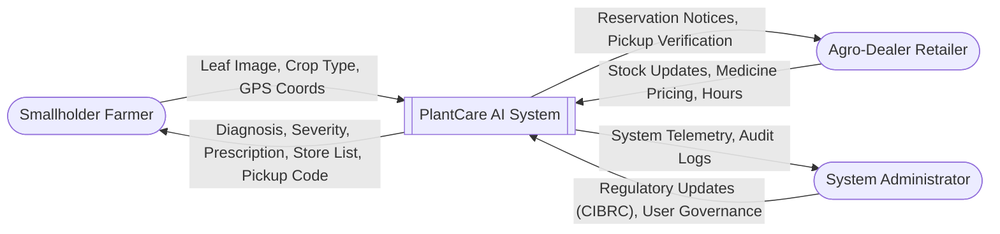
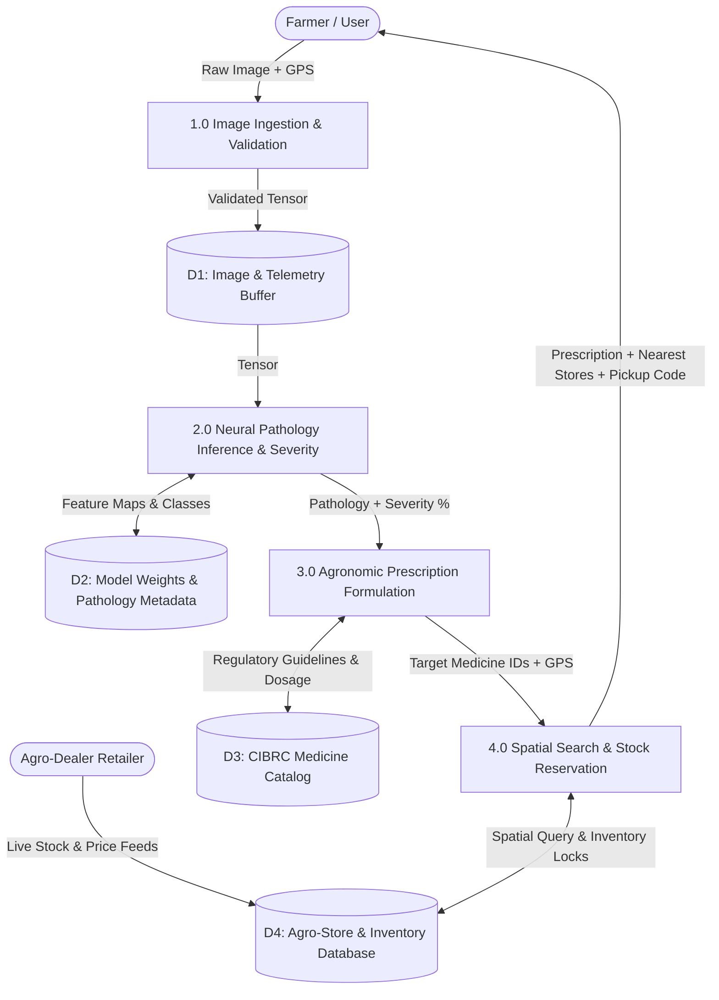
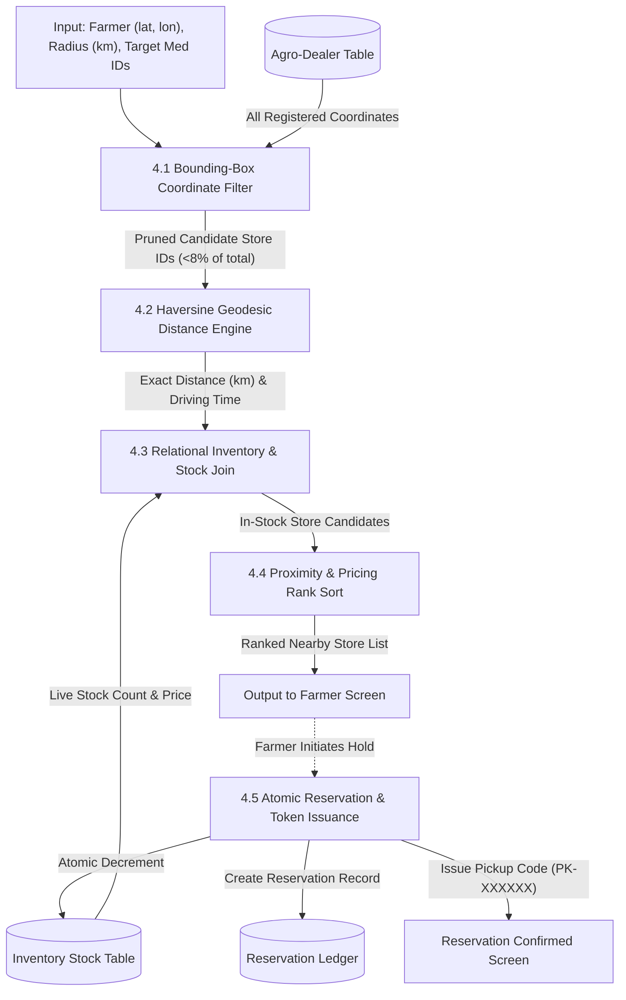

# Data Flow Diagrams (DFD)

## 1. DFD Level 0: Context Diagram
The Level 0 context diagram defines the external boundaries, primary actors, and overarching data flows of PlantCare AI.

---

## 2. DFD Level 1: Major Functional Processes
The Level 1 diagram decomposes the system into four core functional processes and four primary data stores.

---

## 3. DFD Level 2: Decomposed Spatial & Reservation Engine (Process 4.0)
Decomposition of Process 4.0 illustrating bounding-box pre-filtering, Haversine geodesic calculation, inventory joining, and atomic reservation locking.

