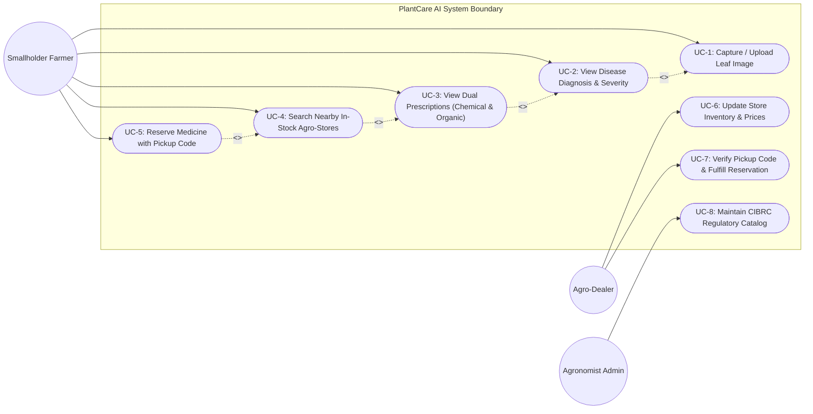
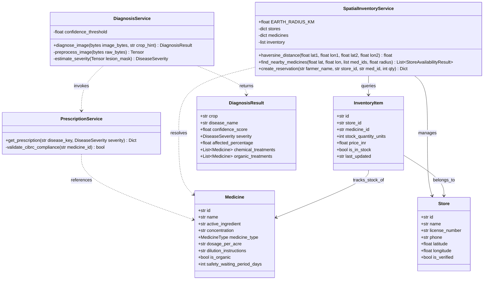
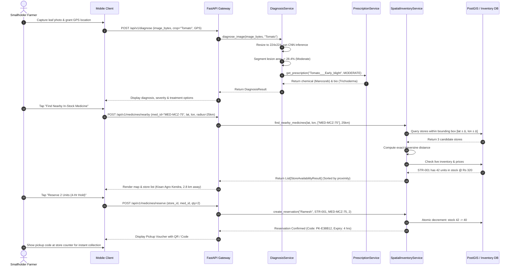

# UML Diagrams: Use Case, Class, and Sequence Models

## 1. Use Case Diagram
Illustrates the actor interactions and system boundary use cases for Farmers, Agro-Dealers, and Agronomist Admins.

---

## 2. UML Class Diagram
Defines the object-oriented structure, class relationships, attributes, and public interface methods.

---

## 3. UML Sequence Diagram: End-to-End User Flow
Illustrates the chronological message flow from initial leaf capture to physical inventory reservation.

